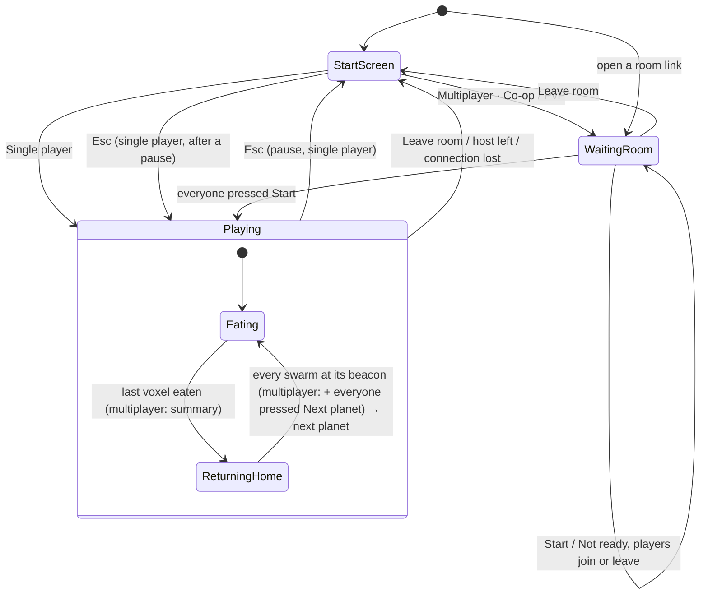

# Architecture

Hive Hunger is a static web page: ES modules, Three.js r128 (UMD build from cdnjs) and PeerJS 1.5.4 (from unpkg) — no build step, no server code. Almost every tunable value lives in `js/config.js` (upgrade costs and the lightning's base values in `js/core/SkillTree.js`).

## Modules

| File | What it does |
| --- | --- |
| `js/main.js` | Entry point: reads `?room=`, creates the game (solo or guest), the settings panel, the start screen, room panel, summary and upgrade tree; Tab / Esc keys; starts the loop |
| `js/config.js` | All parameters: planet, flock, feeding, beacon, marker, network, slider ranges |
| `js/version.js` | Game version (keep in sync with `CHANGELOG.md`) |
| `js/three/Game3D.js` | Scene, camera, input, roles (solo / host / guest), planet lifecycle, HUD data, guest-side handling of network messages |
| `js/three/Player.js` | One player: swarm + leader + beacon + settings + score; per-player simulation step, commands, recall, return home |
| `js/three/Swarm3D.js` | The flock (boids), feeding, collisions, getting unstuck, drawing; `aroundPlanet()` path helper |
| `js/core/Leader.js` | The swarm's "brain": a point the flock heads for; stays at matter, finds new matter, follows clicks |
| `js/three/VoxelPlanet.js` | Voxel planet: terrain, claims, eating, exposed-voxel instancing, raycast, seed, removal log, eaten-voxel run lengths for late joiners; knows about drifting fragment voxels |
| `js/three/Fragments.js` | Pieces bitten off the planet: finding splits (flood fill from the neighbours of eaten voxels), drifting and turning, their own smooth surfaces, eating them, the spatial hash the swarm uses to find and avoid them |
| `js/three/PlanetSurface.js` | Extra planet graphics over the voxels: `smooth` (surface nets) and `wedges` (ramps and corner pieces in the steps), built per 16³ chunk and rebuilt as voxels are eaten |
| `js/three/shapes.js` | Which voxels are solid for a level's `shape`: `sphere`, `cube`, `text` (voxel letters with a colour per letter) |
| `js/core/SkillTree.js` | Upgrade tree data and rules: nodes (branch, parent, cost, effect, layout), buying, adding up the effects |
| `js/ui/TreeView.js` | The tree view (Tab): drawn on a small canvas and scaled up without smoothing (pixel art); hover tooltip, click to buy |
| `js/three/Lightning3D.js` | Chain-lightning bolts (jagged additive lines that flicker out) |
| `js/three/Debris3D.js` | Debris point cloud |
| `js/three/Space3D.js` | Sky sphere with nebulae + star layers (one group, turned by the spin) |
| `js/three/SpawnBeacon.js` | Clickable beacon at each player's spawn point |
| `js/three/ClickMarker.js` | Ring shown where the player clicked |
| `js/net/Net.js` | `NetHost` / `NetGuest` over PeerJS: rooms, joining, pings, timeouts |
| `js/net/Protocol.js` | Binary snapshot, planet and fragment messages |
| `js/ui/Hud.js` | Planet counter, points counter, hints, notices, multiplayer scoreboard and banner |
| `js/ui/ControlPanel.js` | Sliders, the "Eat nearest block" toggle, "Reset to default" |
| `js/ui/LevelSwitch.js` | Level buttons 1–5 under the panel (single player only): `Game3D.jumpToLevel` builds that planet and puts the swarm back at its beacon |
| `js/ui/StartScreen.js` | Start screen (Single player / Co-op / PvP) and the multiplayer waiting room (link, players, Start) |
| `js/ui/Summary.js` | Multiplayer summary after a planet: per-player results, winner, Next planet |
| `js/ui/Lobby.js` | Room panel during a multiplayer match: room, link, leave |
| `js/ui/dom.js` | Small DOM helpers for the menus |
| `js/utils/*` | Noise (fBm), terrain colours, nebula/star colours |

## Game states

- **Start screen** and **waiting room** are the overlay (`StartScreen`); `game.started` is `false`, so swarms wait at their beacons and the planet doesn't turn. In single player **Esc** sets `started` back to `false` (pause) and shows the start screen; Esc again or **Single player** carries on. Creating a room (`Game3D.becomeHost`) starts from scratch: a new planet 1 and a new host player (no points, upgrades or eaten voxels from single player); only the settings panel values are kept.
- **Playing:** `game.started` is `true`. In multiplayer the room panel (`Lobby`, bottom left) has the link and **Leave room**; leaving reloads the page without `?room=`, i.e. back to the start screen.
- Someone who opens a room link while the match is running skips the waiting room.
- **Returning home:** after the last voxel, every swarm flies to its beacon; the next planet appears when all have gathered (or after `beacon.returnTimeoutFrames`). In multiplayer the summary (`Summary`) is open meanwhile and the next planet also waits until every player has pressed **Next planet** (`Player.nextReady`).

## Planet levels and looks

`CONFIG.levels` is a cycle: planet `n` uses entry `(n − 1) mod length` — `shape`, `radiusScale` (× `planet.radius`) and `style`. `Game3D.levelLook(level)` turns it into the planet's radius and style; every client builds the same planet from the level and the seed, so multiplayer needs nothing extra.

Shapes (`shapes.js`) decide which voxels are solid (`sphere`, `cube`, `pair`, `boxes`, `text`). `boxes` lays out every box shape up to max×max×max once (x ≥ y ≥ z, no rotated copies): one row per depth, boxes from the smallest, `gap` apart; each box has its own colour (tags, like the text's letters). A `pair` has `parts` — each part (the sphere and the cube) gets its own terrain, measured from its own centre (`VoxelPlanet.partAt`). The grid is always a cube centred on the origin (`half` = half its edge); each shape also gives the radius the swarm flies around on long trips (`R`: the sphere's radius, the cube's half-edge, half the text's thickness) and a bounding sphere for clicks (`bound`). Terrain colours follow the surface: sphere — depth under the radius, cube — depth under the nearest face; the text uses a colour per letter. Only spheres get the smoothed shading.

Styles change only the graphics — collisions, claims and eating always use the voxels. Every level uses `smooth` (the owner's choice since 0.13.0; an extra-smooth variant was tried in 0.14 and removed); `cubes` and `wedges` stay available. On a `pair`, the sphere's normals lean towards its own centre (like `sphereShading` on single spheres):

- `cubes` — the instanced voxel cubes.
- `smooth` — the cubes are hidden; `PlanetSurface` draws a surface net: one vertex per grid cell the surface passes through (the average of the solid/empty crossings on its edges) and a quad for every solid/empty pair of neighbouring voxels. Steps become slopes and corners round off without a case table. Colours are averaged from the solid voxels around each vertex. The field isn't just solid/empty: a solid voxel has density 0.5 + 0.5 × (strength left), so as it is eaten or weakened the surface over it sinks towards its centre and darkens — the destruction animation on a smooth planet. Text letters must have their pixels touching by a side, or the surface splits them.
- `wedges` — the cubes stay; every empty cell resting on a solid voxel (below = towards the planet centre along the main axis) gets a piece: a ramp next to one solid side, an inner corner next to two adjacent sides, an outer corner next to a solid diagonal.

The surface is split into chunks of 16³ voxels. `VoxelPlanet.remove()` and `showDamage()` mark the chunks around the voxel dirty; `sync()` rebuilds them for up to `budgetMs` (3 ms) per frame, at least one (a guest joining mid-planet rebuilds all at once). Each rebuild first copies the chunk's densities into a small block, then builds the mesh from it. To try a new look: add a builder to `BUILDERS` in `PlanetSurface.js`; a new shape: a case in `shapes.js`; then a level with its name in `CONFIG.levels`.

## Points, upgrades and lightning

- **Points** = `player.score − player.tree.spent`; `score` counts eaten voxels (1 voxel = 1 point).
- **Upgrades** (`SkillTree`): every node is bought once and needs its parent. `Player.base` keeps the slider values; `Player.applyUpgrades()` sets the swarm to base + bonuses (units +, speed ×, bite radius +) and the lightning settings. Moving a slider changes the base, the bonus stays on top.
- **Chain lightning** (`Player.updateLightning`, host / single player): every `interval` seconds a bolt starts at a random drone and jumps to the nearest drone not hit yet within `range`, `jumps` times. `VoxelPlanet.weakenAlong` takes `damage × strength` from every voxel on the path (down to 5%, never removing it). `Game3D.showBolt` draws it and the host sends it to guests.
- **Destruction animation** (`VoxelPlanet.showDamage`): whenever a voxel loses strength the smooth surface over it sinks and darkens (see above); with the `cubes` style its instance is scaled down (to 45%), darkened and jittered instead. Removal emits debris as before. Guests don't receive voxel strength, so they see only the debris.
- **Multiplayer:** each player has their own tree on the host; a guest sends `buy`, the host checks the guest's points and answers with `tree`.

## Frames of reference and the planet spin

The simulation runs in the **planet's frame**: voxels never move. To make the planet look like it spins, the camera, the sky group, the sun and the beacons (they live in the sky group) turn around the planet by `spin` (`planet.spinSpeed` per frame). The swarm flies in the planet's frame, so on screen it turns together with the planet. A beacon moves in the planet's frame, so a swarm flying home follows a slowly moving target.

## One frame (solo / host)

Until the match has started (`game.started`: Single player chosen, or every player in the room pressed Start; Esc in single player sets it back to `false`, which pauses the game) the frame only draws: swarms wait at their beacons and the planet doesn't turn.

1. `spin += spinSpeed`, apply it to camera, sky and sun.
2. For every player (`Player.update`):
   - collect exposed voxels within `leader.feedSenseRadius` of the swarm target (`VoxelPlanet.exposedNear`) and count the free (unclaimed) ones;
   - update the leader: stay while free voxels are near, otherwise drift to the nearest free voxel; follow a click or the beacon when told to;
   - update the swarm (`Swarm3D.update`).
3. Drifting pieces move and turn (`Fragments.step`); voxels eaten this frame are checked for splits, and every part smaller than the rest comes loose (host: sent to the guests).
4. If the planet's last voxel is gone: every swarm flies home; when all have gathered (or after a timeout) the next planet appears.
5. Host only: every `net.snapshotEvery` frames, send a snapshot to the guests (every `fragments.syncEvery` frames also where the pieces are).

## The swarm (`Swarm3D.update`)

- **Flocking (boids):** separation (within `spacing`), alignment and cohesion with neighbours found through a spatial hash grid, plus steering towards the unit's target. Every unit flies at the same constant `speed`; only its direction changes, at most `turnRate` per frame. What is drawn follows that direction smoothly (`turnSmoothing`).
- **Feeding:** a unit without a bite picks one — near the swarm target, or (with "Eat nearest block") the nearest free voxel to itself. The voxel is **claimed** (`VoxelPlanet.claims`), so nobody else takes or bites it; bites are shared only when the planet has fewer exposed voxels than there are units. A unit lands when it touches its bite (or a free voxel right next to it) or comes within `reachDistance`, then eats a crater of radius `power` over `eatFrames` frames, skipping voxels claimed by others.
- **Collisions:** movement goes axis by axis in substeps; a solid voxel stops movement on that axis — no bounce and no passing through; the unit slides along the surface. Units in passing never eat.
- **Long trips:** `aroundPlanet()` gives a waypoint over the surface when the straight path would go through the planet, or straight up when the unit is down in a pit.
- **Giving up on a bite:** a unit with a bite that hasn't eaten for `retarget.frames` (600 = 10 s) stops for `retarget.pauseFrames` (30 = 0.5 s), then `retarget()` picks another free bite while still holding the old one (so the old one isn't picked again); with no other, it keeps the old one.
- **Getting unstuck:** no progress for `stuck.frames` while touching a wall → bite through the blocking voxel (if unclaimed) or turn in a random direction.

## The planet (`VoxelPlanet`)

- Voxels in the level's shape (`shapes.js`): a full-size sphere (radius 24 / voxel 0.5) has ≈ 463 000 voxels, planet 1 ≈ 165 000, the cube ≈ 314 000, the text ≈ 8 000. Colours come from 3D noise on the sphere (`terrainColor`) for the outer `terrainDepth`, rock below (the text: a colour per letter).
- Only **exposed** voxels (with an empty neighbour) are instances of the `InstancedMesh`; when a voxel is eaten, its hidden neighbours are added. This keeps tens of thousands of instances instead of hundreds of thousands.
- **Pieces that come loose** (`Fragments.js`). Every eaten voxel is noted; once per frame the eaten voxels are grouped into connected clusters, and for each cluster the solid voxels next to it — which were all one body through it — get one flood fill each, run in turns, one voxel at a time. Fills that meet merge. As soon as at most one fill is still growing, every fill that ran out is a closed part smaller than the rest and comes loose; if all of them ran out, the biggest stays, and so do parts of equal biggest size. The work is capped at `fragments.maxSteps` voxels (then no split is found). A loose part's voxels leave the static grid (`hp` 0 there, so collisions, the surface and instancing ignore them; `left` doesn't change — coming loose is not eating) and keep their indices: their strength lives in the fragment's own small grid, drawn by its own `PlanetSurface` (one chunk). A fragment has a position, rotation, velocity and spin; a voxel's place is position + rotation × (its grid centre − the fragment's original centre). `cellCenter`, `solid`, `bite`, `biteSphere`, `remove`, `exposedNear`, `nearestFree` and `findMatter` all know about fragment voxels, so the swarm claims, chases, lands on and eats them like any other; `fragments.at(p)` lets collisions stop units at a fragment (through a spatial hash of 8-unit cells). A unit landed on a drifting bite moves with it. Voxels eaten off a fragment are checked the same way in the fragment's own grid (`splitFragment`); a part that comes loose becomes a new fragment (its voxels move over from the parent, not eaten) that starts where it was in the parent, with the parent's velocity at that point (incl. the turn), a small push away, and a slightly different spin. `origin` (where it came off) limits its drift to `maxDistance`.
- `seed` makes the planet reproducible. `log` collects eaten voxels for the network; `eatenRuns()` / `applyEatenRuns()` transfer the eaten voxels to a guest who joins mid-planet (run lengths over the grid — small even for large grids).

## Roles

- **solo** — everything above runs locally; one player.
- **host** — the same, with up to 3 more players whose commands and settings arrive over the network, plus snapshots sent out.
- **guest** — no simulation: builds the planet from the host's seed, removes the voxels the host reports (emitting debris locally), makes the pieces the host sends and moves them with the same physics (corrected from the host), shows swarm positions from snapshots (eased towards them every frame), sends clicks, recall, settings, Start / Not ready, Next planet and upgrade purchases. See `docs/MULTIPLAYER.md`.
