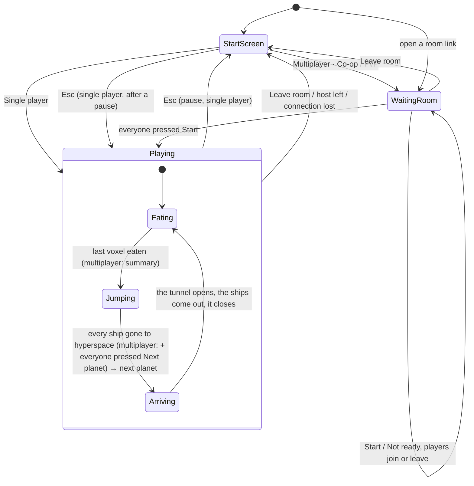

# Architecture

Hive Hunger is a static web page: ES modules, Three.js r128 (UMD build from cdnjs) and PeerJS 1.5.4 (from unpkg) — no build step, no server code. Almost every tunable value lives in `js/config.js` (upgrade costs and the lightning's base values in `js/core/SkillTree.js`).

## Modules

```
js/
  main.js, config.js, version.js
  core/          rules without graphics: the swarm's brain, the upgrade tree
  three/
    game/        the game: Game3D (+ its parts), Player
    swarm/       the swarm: Swarm3D (+ its parts), steering
    planet/      the voxel planet, its smooth surface, drifting pieces, level shapes
    effects/     lightning, support bolts, orbs, black holes, debris
    scene/       sky, spawn tunnel, click marker
    textures.js  small glow / gradient textures shared by the effects
  net/           multiplayer over PeerJS, binary messages
  ui/            HTML panels and menus
  utils/         noise, terrain and sky colours
css/             one stylesheet per part of the page
```

**Classes split over several files.** `Game3D`, `Swarm3D`, `Player` and `VoxelPlanet` are big, so their methods live in several files: each part file exports an object of methods (`export const Input = { bindInput() {…}, … }`), and the class file adds them to its prototype at the end (`Object.defineProperties(Game3D.prototype, Object.getOwnPropertyDescriptors(part))`). The methods behave exactly as if they were written in the class (`this` is the game / swarm); to find one, search for its name. A new part: write the file, import it in the class file and add it to the list there.

| File | What it does |
| --- | --- |
| `js/main.js` | Entry point: reads `?room=`, creates the game (solo or guest), the settings panel, the start screen, room panel, summary and upgrade tree; Tab / Esc keys; starts the loop |
| `js/config.js` | All parameters: planet, flock, feeding, ship types, spawn tunnel, hyperspace jump, marker, network, slider ranges |
| `js/version.js` | Game version (keep in sync with `CHANGELOG.md`) |
| `js/settings.js` | The player's own settings (camera turning, zoom speed, FPS counter, resolution, smooth edges, effects), remembered in the browser; `onChange` listeners |
| **`js/three/game/`** | |
| `Game3D.js` | Scene, camera, renderer, roles (solo / host / guest), players and their spawns, planet lifecycle, the frame loop (`update`, `updateSim`, `start`) |
| `input.js` | (Game3D) mouse and touch: tap to steer or to call the swarm back at its tunnel, camera turning and zoom, screen → world point. The camera's orientation is a quaternion (`orbit.q`) turned around its own axes, so it can go over the poles; the planet's spin is added about the world's Y axis |
| `destruction.js` | (Game3D) what ships do to voxels: bites, storm bolts, bomber blasts, orb bursts, support lightning, black holes swallowing pieces |
| `host.js` | (Game3D) host side: summary after a planet, PvP winner, Next planet, guests' commands and purchases, buying upgrades |
| `guest.js` | (Game3D) guest side: following the host — snapshots, planets, pieces, jumps, orbs, bolts, black holes, settings, tree |
| `hud.js` | (Game3D) HUD text: progress, status line (jumping, called back, connecting — no description of the controls), scores and pings, notices |
| `graphics.js` | (Game3D) graphics settings: making the renderer (resolution, smooth edges — a new renderer and canvas when it changes, input bound again), amount of effects, frames per second |
| `players.js` | Player names and colours in multiplayer |
| `Player.js` | One player: swarm + leader + tunnel + settings + score; setting up, commands, recall, settings, a new planet, the per-player frame step |
| `arrival.js` | (Player) the tunnel: ships coming out of it, the jump to hyperspace, the spawn point and where it is in the world |
| `ships.js` | (Player) ships with their own jobs: tugs towing pieces home, removing bombers that blew up, orbs, support ships' lightning |
| `upgrades.js` | (Player) points, buying upgrades, bonuses on top of the sliders, chain lightning |
| **`js/three/swarm/`** | |
| `Swarm3D.js` | The flock (boids): per-unit state, neighbour grid, feeding, collisions, getting unstuck, aiming, drawing the ships |
| `types.js` | (Swarm3D) ship types by unit index, their colours, swapping two units |
| `remote.js` | (Swarm3D) a guest's copy of a swarm; the beam and bolt lists sent to guests |
| `warp.js` | (Swarm3D) the jump to hyperspace and its streaks |
| `beams.js` | (Swarm3D) laser beams, storm ships' forked lightning |
| `tows.js` | (Swarm3D) tugs' tractor beams shaped to the piece |
| `drills.js` | (Swarm3D) drills' spiral bits, the list of drilling units |
| `steering.js` | `aroundPlanet()` (fly around the planet, not through it), `nearOwnBite()` |
| **`js/three/planet/`** | |
| `VoxelPlanet.js` | Voxel planet: building the grid from the level's shape and seed, coordinates, what is solid (also on drifting pieces), syncing, disposing |
| `look.js` | (VoxelPlanet) materials, terrain and letter colours, the drawn cubes (exposed voxels as instances), damage on them |
| `eating.js` | (VoxelPlanet) bites, claims, chain lightning weakening voxels, removing voxels (grid or piece), the removal log, shattering |
| `search.js` | (VoxelPlanet) exposed voxels near a point, the nearest free voxel, matter for the brain, raycasts |
| `runs.js` | (VoxelPlanet) eaten voxels as run lengths for players who join mid-planet |
| `grid.js` | `BITE` results, the six neighbours, offsets within 2 voxels |
| `Fragments.js` | Pieces bitten off the planet: finding splits (flood fill from the neighbours of eaten voxels), drifting and turning, their own smooth surfaces, eating them, the spatial hash the swarm uses to find and avoid them |
| `PlanetSurface.js` | Extra planet graphics over the voxels: `smooth` (surface nets) and `wedges` (ramps and corner pieces in the steps), built per 16³ chunk and rebuilt as voxels are eaten (within `budgetMs` per frame) |
| `shapes.js` | Which voxels are solid for a level's `shape`: `sphere`, `cube`, `pair`, `boxes`, `text` |
| **`js/three/effects/`** | |
| `Lightning3D.js` | Lightning bolts (chain lightning, storm ships): a jagged 1-px white core with a thin glow ribbon (`glowPx` = 2 px each side, turned to the camera every frame), flickering out |
| `Zaps.js` | Support ships' lightning: a seeded, bent bolt through a chain of ships with flowing energy and branches, run from ship to ship; reports each finished jump |
| `Orbs.js` | Plasma orbs of orb ships: flight to the target, pulsing glow, fiery tail (a point cloud with per-point size and colour), burst flash |
| `BlackHoles.js` | Black holes after bomber blasts: strength over time, pulling and swallowing debris and pieces, the lensing render pass |
| `Debris3D.js` | Debris point cloud |
| **`js/three/scene/`** | |
| `Space3D.js` | Sky sphere with nebulae + star layers (one group, turned by the spin) |
| `Portal3D.js` | The subspace tunnel at each player's spawn point: opens, closes, pulses; ships come out of it; click it to call the swarm back |
| `ClickMarker.js` | Ring shown where the player clicked |
| `js/three/textures.js` | Canvas textures: radial and linear gradients, the shared glow-band texture |
| **`js/core/`** | |
| `Leader.js` | The swarm's "brain": a point the flock heads for; stays at matter, finds new matter, follows clicks |
| `SkillTree.js` | Upgrade tree data and rules: nodes (branch, parent, cost, effect, layout), buying, adding up the effects |
| **`js/net/`** | |
| `Net.js` | `NetHost` / `NetGuest` over PeerJS: rooms, joining, pings, timeouts, events |
| `Protocol.js` | Binary snapshot, planet and fragment messages |
| **`js/ui/`** | |
| `Hud.js` | Planet counter, points counter, hints, notices, multiplayer scoreboard and banner |
| `ControlPanel.js` | Sliders (Units, Speed, Power, Turning), "Reset to default" |
| `ShipTypes.js` | Ship types panel (bottom-right): linked sliders for eaters and every type in `SHIP_KINDS` (together all your units), each with arrows (one ship less / more) and a lock checkbox |
| `LevelSwitch.js` | Level buttons 1–5 under the panel (single player only): `Game3D.jumpToLevel` builds that planet and lets the swarm out of its tunnel again |
| `StartScreen.js` | Start screen (Single player / Co-op / PvP) and the multiplayer waiting room (link, players, Start) |
| `Summary.js` | Multiplayer summary after a planet: per-player results, winner, Next planet |
| `Lobby.js` | Room panel during a multiplayer match: room, link, leave |
| `TreeView.js` | The tree view (Tab): drawn on a small canvas and scaled up without smoothing (pixel art); hover tooltip, click to buy |
| `SettingsView.js` | The Settings screen in the menu: Mouse (controls, camera turning, zoom speed), Keyboard (keys), Graphics (FPS counter, resolution, smooth edges, effects), Reset settings, Back |
| `dom.js` | Small DOM helpers for the menus |
| `js/utils/*` | Noise (fBm), terrain colours, nebula/star colours |
| **`css/`** | Loaded in this order (later files may override earlier ones): `base.css` (colours, page, hidden helpers, version), `hud.css`, `panel.css` (settings, level switch, ship types; narrow screens), `lobby.css`, `menu.css` (start screen, waiting room), `summary.css`, `points.css`, `tree.css` |

## Game states



- **Start screen** and **waiting room** are the overlay (`StartScreen`); `game.started` is `false`, so swarms wait at their tunnels and the planet doesn't turn. In single player **Esc** sets `started` back to `false` (pause) and shows the start screen; Esc again or **Single player** carries on. Creating a room (`Game3D.becomeHost`) starts from scratch: a new planet 1 and a new host player (no points, upgrades or eaten voxels from single player); only the settings panel values are kept.
- **Playing:** `game.started` is `true`. In multiplayer the room panel (`Lobby`, bottom left) has the link and **Leave room**; leaving reloads the page without `?room=`, i.e. back to the start screen.
- Someone who opens a room link while the match is running skips the waiting room.
- **Jumping:** after the last voxel, `Player.jumpOut` sets `homeMode = 'jump'` and `Swarm3D.jumpAll` gives every ship a random delay within `swarm.warp.window`; when it runs out (`stepWarp`, host) the ship speeds up away from the planet (`accel`, up to `maxSpeed`), leaves a streak (`renderTrails`) and after `warp.frames` is hidden. The next planet appears when every ship is hidden (`Player.departed`) or after `beacon.returnTimeoutFrames`.
- **Arriving:** on a new planet every ship is hidden; `Player.updateArrival` opens the tunnel (`pending → opening`), lets the ships out at random moments within `portal.emergeWindow` at its mouth, heading out of it (`emerging`), and `linger` frames after the last closes it (`done`). In multiplayer the summary (`Summary`) is open meanwhile and the next planet also waits until every player has pressed **Next planet** (`Player.nextReady`).

## Planet levels and looks

`CONFIG.levels` is a cycle: planet `n` uses entry `(n − 1) mod length` — `shape`, `radiusScale` (× `planet.radius`) and `style`. `Game3D.levelLook(level)` turns it into the planet's radius and style; every client builds the same planet from the level and the seed, so multiplayer needs nothing extra.

Shapes (`shapes.js`) decide which voxels are solid (`sphere`, `cube`, `pair`, `boxes`, `text`). `boxes` lays out every box shape up to max×max×max once (x ≥ y ≥ z, no rotated copies): one row per depth, boxes from the smallest, `gap` apart; each box has its own colour (tags, like the text's letters). A `pair` has `parts` — each part (the sphere and the cube) gets its own terrain, measured from its own centre (`VoxelPlanet.partAt`). The grid is always a cube centred on the origin (`half` = half its edge); each shape also gives the radius the swarm flies around on long trips (`R`: the sphere's radius, the cube's half-edge, half the text's thickness) and a bounding sphere for clicks (`bound`). Terrain colours follow the surface: sphere — depth under the radius, cube — depth under the nearest face; the text uses a colour per letter. Only spheres get the smoothed shading.

Styles change only the graphics — collisions, claims and eating always use the voxels. Every level uses `smooth` (the owner's choice since 0.13.0; an extra-smooth variant was tried in 0.14 and removed); `cubes` and `wedges` stay available. On a `pair`, the sphere's normals lean towards its own centre (like `sphereShading` on single spheres):

- `cubes` — the instanced voxel cubes.
- `smooth` — the cubes are hidden; `PlanetSurface` draws a surface net: one vertex per grid cell the surface passes through (the average of the solid/empty crossings on its edges) and a quad for every solid/empty pair of neighbouring voxels. Steps become slopes and corners round off without a case table. Colours are averaged from the solid voxels around each vertex. The field isn't just solid/empty: a solid voxel has density 0.5 + 0.5 × (strength left), so as it is eaten or weakened the surface over it sinks towards its centre and darkens — the destruction animation on a smooth planet. Text letters must have their pixels touching by a side, or the surface splits them.
- `wedges` — the cubes stay; every empty cell resting on a solid voxel (below = towards the planet centre along the main axis) gets a piece: a ramp next to one solid side, an inner corner next to two adjacent sides, an outer corner next to a solid diagonal.

The surface is split into chunks of 16³ voxels. `VoxelPlanet.remove()` and `showDamage()` mark the chunks around the voxel dirty; `sync()` rebuilds them for up to `budgetMs` (3 ms) per frame, at least one (a guest joining mid-planet rebuilds all at once). Each rebuild first copies the chunk's densities into a small block, then builds the mesh from it. To try a new look: add a builder to `BUILDERS` in `PlanetSurface.js`; a new shape: a case in `shapes.js`; then a level with its name in `CONFIG.levels`.

## Points, upgrades and lightning

- **Points** = `player.score − player.tree.spent`; `score` counts eaten voxels (1 voxel = 1 point).
- **Upgrades** (`SkillTree`): every node is bought once and needs its parent. `Player.base` keeps the slider values; `Player.applyUpgrades()` sets the swarm to base + bonuses (units +, speed ×, bite radius +) and the lightning settings. Moving a slider changes the base, the bonus stays on top.
- **Chain lightning** (`Player.updateLightning`, host / single player): every `interval` seconds a bolt starts at a random drone and jumps to the nearest drone not hit yet within `range`, `jumps` times. `VoxelPlanet.weakenAlong` takes `damage × strength` from every voxel on the path (down to 5%, never removing it). `Game3D.showBolt` draws it and the host sends it to guests.
- **Destruction animation** (`VoxelPlanet.showDamage`): whenever a voxel loses strength the smooth surface over it sinks and darkens (see above); with the `cubes` style its instance is scaled down (to 45%), darkened and jittered instead. Removal emits debris as before. Guests don't receive voxel strength, so they see only the debris.
- **Multiplayer:** each player has their own tree on the host; a guest sends `buy`, the host checks the guest's points and answers with `tree`.

## Frames of reference and the planet spin

The simulation runs in the **planet's frame**: voxels never move. To make the planet look like it spins, the camera, the sky group, the sun and the tunnels (they live in the sky group) turn around the planet by `spin` (`planet.spinSpeed` per frame). The swarm flies in the planet's frame, so on screen it turns together with the planet. A beacon moves in the planet's frame, so a swarm flying home follows a slowly moving target.

## One frame (solo / host)

Until the match has started (`game.started`: Single player chosen, or every player in the room pressed Start; Esc in single player sets it back to `false`, which pauses the game) the frame only draws: swarms wait at their tunnels and the planet doesn't turn.

1. `spin += spinSpeed`, apply it to camera, sky and sun.
2. For every player (`Player.update`):
   - collect exposed voxels within `leader.feedSenseRadius` of the swarm target (`VoxelPlanet.exposedNear`) and count the free (unclaimed) ones;
   - update the leader: stay while free voxels are near, otherwise drift to the nearest free voxel; follow a click or the tunnel when told to;
   - update the swarm (`Swarm3D.update`).
3. Drifting pieces move and turn (`Fragments.step`); voxels eaten this frame are checked for splits, and every part smaller than the rest comes loose (host: sent to the guests).
4. If the planet's last voxel is gone: every swarm flies home; when all have gathered (or after a timeout) the next planet appears.
5. Host only: every `net.snapshotEvery` frames, send a snapshot to the guests (every `fragments.syncEvery` frames also where the pieces are).

## The swarm (`Swarm3D.update`)

- **Flocking (boids):** separation (within `separationDistance`), alignment and cohesion with neighbours found through a spatial hash grid, plus steering towards the unit's target. Every unit flies at the same constant `speed`; only its direction changes, at most `turnRate` per frame. The ship's nose (`look`) follows that direction smoothly (`turnSmoothing`, slider Turning) — in the simulation, because a landed ship eats only once its nose faces its bite within `aimAngle` (`aim()`).
- **Feeding:** a unit without a bite picks the nearest free voxel to itself (after a click: to the clicked point) and flies straight to it — no alignment or cohesion while it has a bite, only separation. The voxel is **claimed** (`VoxelPlanet.claims`), so nobody else takes or bites it; bites are shared only when the planet has fewer exposed voxels than there are units. A unit lands when it touches its bite (or a free voxel right next to it) or comes within `reachDistance`, then eats a crater of radius `power` over `eatFrames` frames, skipping voxels claimed by others.
- **Collisions:** movement goes axis by axis in substeps; a solid voxel stops movement on that axis — no bounce and no passing through; the unit slides along the surface. Units in passing never eat.
- **Long trips:** `aroundPlanet()` gives a waypoint over the surface when the straight path would go through the planet, or straight up when the unit is down in a pit.
- **Laser ships:** units `0 … lasers−1` (`Swarm3D.lasers`, from the player's `lasers` setting, at most all units) are red laser ships: they land at `laser.reach` (2.5) from their bite instead of `reachDistance`, eat it from there — but only once their heading (`look`, turned in the simulation by `turnLook`) faces the bite within `aimAngle` (`aim()`; eaters too) — and fly at `laser.speedFactor` (0.9) × the speed. `render(camera)` colours the units (instance colours) and draws a glowing band (a camera-facing quad with a white-core-to-red gradient, additive) from every firing laser ship to its bite, plus a glow sprite where it hits; on a guest the beams come from the snapshot.
- **Storm ships:** the next `storms` units after the laser ships. They land at laser range like laser ships and, once aimed, call `world.storm` → `Game3D.stormCell` instead of `bite`: the damage a laser would do this frame (`strength / eatFrames` × the voxels of a Power crater) is split — `storm.centre` (0.4) on the bite, `storm.side` (0.3) on each of the two nearest unclaimed voxels of the same body (`VoxelPlanet.nearestAround`). `renderStorms` shows a flash every `storm.flashEvery` frames with the chain-lightning look (`Lightning3D`): ship → fork point at `storm.fork` (70%) → bite, and two weaker bolts from the fork to the side voxels.
- **Tugs:** the next `tugs` units after the storm ships; they never pick bites. `Player.updateTugs` (host) gives each tug the nearest drifting piece nobody tows (`fragment.tug`) and a point to fly to (`Swarm3D.tugGoal`): the piece's near side, or — once within `tug.range` and holding it (`fragment.towed`, no damping or drift limit) — ahead of the piece towards home, while it sets the piece's velocity towards the tunnel (`aroundPlanet` waypoints) at `tug.pull` × the swarm speed. At the tunnel (it opens for a moment) `deliver` removes the piece's voxels as eaten (logged for guests) and adds `tug.reward` × their number to the score. `Swarm3D.tows` ([unit, piece id]) drives the tractor beam meshes (`shapeTow`): the piece's outer voxels (a sample of `tug.outlinePoints`) are flattened across the beam onto the piece's centre, their convex hull grown to `tug.outlineScale` (5% larger) plus half a voxel is the outline, and the beam is a fan of additive triangles from the tug to it (glow fading away from the tug) plus light streaks ending inside it, re-drawn every few frames; guests get the tows from the snapshot.
- **Bombers:** the next `bombers` units after the tugs. They pick bites like eaters; landed, they call `world.bomb` → `Game3D.explode`: every voxel within `bomber.radius` of the bite (grid and drifting pieces) is removed as eaten, a point each, and a black hole is added (and sent to the guests). The bomber is put on `Swarm3D.dying`; after the update `Player.removeDead` swaps it to the end of the swarm (past the other bombers and the eaters, so every type keeps its places) and lowers the Units and Bombers settings by one (guests are told with a `settings` message).
- **Black holes** (`BlackHoles.js`): per hole a strength 0 → 1 → 0 over `grow` / `hold` / `shrink` frames. Each frame it pulls debris and (host) drifting pieces within `range`, gently (`pullDebris`, `pullPieces`, `maxPieceSpeed`); debris within `core` is gone, a piece is swallowed (`Game3D.swallow`). Drawing: while a hole is up the scene is rendered into a texture and then drawn through a full-screen shader that moves each pixel's sample point like a point lens (β = θ − θE²/θ, θE = `size` × strength projected on screen), with a black disc inside 0.55 θE and a thin ring.
- **Orb ships:** the next `orbs` units after the bombers. They land at `orb.range` from their bite and, aimed, call `world.fireOrb` → `Game3D.fireOrb` (`Orbs.js`) unless their orb is still flying (`Swarm3D.orbOut` = its id). The orb flies at `orb.speed`, following its target voxel (on the host), leaving tail sparks; at the target `Game3D.orbBurst` → `destroySphere(orb.blast)` and `Player.orbDone` lets the ship fire again. Guests get `{t:'orb'}` and fly the same orb (the burst's voxels arrive in snapshots).
- **Support ships:** the next `supports` units after the orb ships; they never pick bites. `Player.updateSupport` counts down `Swarm3D.zapWait` per support ship; at 0 it builds a chain (the ship, then up to `support.jumps` random other ships, each within `support.jumpRange` of the last) and calls `Game3D.zap`, which hands it to `Zaps.add` with a random seed (sent to guests). `Zaps` makes the shape from the seed — per jump a smooth random bend across it (zero at the ships) plus a little jag, and short forked branches — relative to the ships, so it follows them; the bolt's head runs along the chain over `support.life` frames and each finished jump calls back with its world points, where the host destroys every voxel on the way (grid and pieces). Drawn as 1-px cores with vertex colours (energy pulses moving along) and camera-facing glow ribbons (4 px main, 2 px branches).
- **Cleaners:** the next `cleaners` units after the support ships. Instead of `pickFood` they call `world.pickScrap`: the nearest unclaimed voxel of a drifting piece with at most `cleaner.maxPiece` voxels (the player lists those pieces once a frame, `Player.scraps`); with none, they have no bite and fly with the swarm. They land and bite-through-when-stuck only on such voxels (`world.isScrap`), so they never eat the planet or a bigger piece; a bite that stops being one (a slider moved the unit to another type) is let go.
- **Drills:** the next `drills` units after the cleaners. They pick bites like eaters; landed on a planet voxel they pick a direction (towards the centre, ± `drill.spread` at random, `drillDir`), turn to it (`aimDrill`), drop the bite and drill: every frame they move `drill.speed` along it and call `world.drill` → `Game3D.destroySphere(drill.radius)` just ahead of the nose, until `drill.emptyFrames` frames without a voxel or `drill.maxLength` (`drillLeft`). Drilling ships skip steering and collisions. Bits (`swarm/drills.js`): a cone with a spiral texture along the drawn heading, turning; the host sends which units drill in the snapshot.
- **Piercers:** the last `piercers` units. Ranged like laser ships (they land at `piercer.reach`, 10 units). Once aimed at a grid bite they lock the line from themselves through it (`pierceDir`), drop the bite and fire along the line every frame: `world.pierceLine` → `Game3D.pierceLine` walks it half a voxel at a time out to `piercer.length` and bites the first `piercer.pierce` solid voxels (claimed ones passed over) for `piercer.damage` × the eater rate; the beam ends at the nearest one (`pierceEnd`). With none left it is through: `pierceAfter` counts `piercer.afterFrames` (2 s), then `pierceOn` goes off and the ship picks its next bite. On a drifting piece they just bite it (`Game3D.pierceCell`). Drawing (`swarm/beams.js`): a second set of beam meshes in orange (`makeBeams` takes the colours from the config) and a yellow spiral bolt per beam every `flashEvery` frames (`Lightning3D` with a 4-px glow). Their beams go to guests in the same beam list as lasers.
- **Ship types in one list:** `SHIP_KINDS` in `config.js` is the order of the types in the swarm (`lasers`, `storms`, `tugs`, `bombers`, `orbs`, `supports`, `cleaners`, `drills`, `piercers`; the rest eat). Each key is a `Player` setting, a `Swarm3D` count and a Ship types slider; its `CONFIG.swarm` entry is the key without the last letter (`kindConfig`: `cleaners` → `cleaner`, with `count` and `color`). `Swarm3D.kindStart(kind)` / `isKind(i, kind)` find a type's units; `Player.splitKinds` fills them in order. A new type: add its key there (and its config entry), then its behaviour; the snapshot carries one u16 per type.
- **Colours:** by ship type for every player (`eaterColor`, then each type's `color`).
- **Giving up on a bite:** a unit with a bite that hasn't eaten for `retarget.frames` (600 = 10 s) stops for `retarget.pauseFrames` (30 = 0.5 s), then `retarget()` picks another free bite while still holding the old one (so the old one isn't picked again); with no other, it keeps the old one.
- **Getting unstuck:** no progress for `stuck.frames` while touching a wall → bite through the blocking voxel (if unclaimed) or turn in a random direction.

## The planet (`VoxelPlanet`)

- Voxels in the level's shape (`shapes.js`): a full-size sphere (radius 24 / voxel 0.5) has ≈ 463 000 voxels, planet 1 ≈ 165 000, the cube ≈ 314 000, the text ≈ 8 000. Colours come from 3D noise on the sphere (`terrainColor`) for the outer `terrainDepth`, rock below (the text: a colour per letter).
- Only **exposed** voxels (with an empty neighbour) are instances of the `InstancedMesh`; when a voxel is eaten, its hidden neighbours are added. This keeps tens of thousands of instances instead of hundreds of thousands.
- **Pieces that come loose** (`Fragments.js`). Every eaten voxel is noted; once per frame the eaten voxels are grouped into connected clusters, and for each cluster the solid voxels next to it — which were all one body through it — get one flood fill each, run in turns, one voxel at a time. Fills that meet merge. As soon as at most one fill is still growing, every fill that ran out is a closed part smaller than the rest and comes loose; if all of them ran out, the biggest stays, and so do parts of equal biggest size. The work is capped at `fragments.maxSteps` voxels (then no split is found). A loose part's voxels leave the static grid (`hp` 0 there, so collisions, the surface and instancing ignore them; `left` doesn't change — coming loose is not eating) and keep their indices: their strength lives in the fragment's own small grid, drawn by its own `PlanetSurface` (one chunk). A fragment has a position, rotation, velocity and spin; a voxel's place is position + rotation × (its grid centre − the fragment's original centre). `cellCenter`, `solid`, `bite`, `biteSphere`, `remove`, `exposedNear`, `nearestFree` and `findMatter` all know about fragment voxels, so the swarm claims, chases, lands on and eats them like any other; `fragments.at(p)` lets collisions stop units at a fragment (through a spatial hash of 8-unit cells). A unit landed on a drifting bite moves with it. Voxels eaten off a fragment are checked the same way in the fragment's own grid (`splitFragment`); a part that comes loose becomes a new fragment (its voxels move over from the parent, not eaten) that starts where it was in the parent, with the parent's velocity at that point (incl. the turn), a small push away, and a slightly different spin. `origin` (where it came off) limits its drift to `maxDistance`.
- `seed` makes the planet reproducible. `log` collects eaten voxels for the network; `eatenRuns()` / `applyEatenRuns()` transfer the eaten voxels to a guest who joins mid-planet (run lengths over the grid — small even for large grids).

## Roles

- **solo** — everything above runs locally; one player.
- **host** — the same, with up to 3 more players whose commands and settings arrive over the network, plus snapshots sent out.
- **guest** — no simulation: builds the planet from the host's seed, removes the voxels the host reports (emitting debris locally), makes the pieces the host sends and moves them with the same physics (corrected from the host), shows swarm positions from snapshots (eased towards them every frame), sends clicks, recall, settings, Start / Not ready, Next planet and upgrade purchases. See `docs/MULTIPLAYER.md`.

## Performance

Where the time goes, measured in headless Chromium (software WebGL, so drawing is far slower than on a real GPU) on planet 2 with Speed 0.2 and Power 1.5 (measured with up to 1500 units, before swarms were limited to 100 in 0.26.0):

| Units | Simulation per frame | Biggest parts |
| --- | --- | --- |
| 20 | ≈ 3.5 ms | rebuilding the smooth surface (up to `budgetMs` = 3 ms, see below) |
| 300 | ≈ 7 ms | surface 3–4 ms, swarm 2 ms, pieces 1–2 ms |
| 1500 | ≈ 16 ms | surface (planet and pieces), swarm ≈ 2 ms of its own, bites (`biteSphere`), finding food, pieces (≈ 250) |

- **The smooth surface** is the biggest cost while a lot is eaten: every bite marks 16³ chunks dirty and `PlanetSurface.sync` rebuilds them for up to `budgetMs` per frame (the rest waits for the next frames), so the frame time stays bounded and a faster builder shows changes sooner rather than saving time. Each drifting piece has its own small surface, rebuilt when it is bitten.
- **Black holes** draw the scene twice (into a render target, then the lensing pass) while one is open.
- **Simple things to keep:** no allocation in per-unit loops (scratch vectors at module level or on the object), typed arrays for per-unit state, one shared texture for effects that come in many copies (`textures.js`, warp streaks, tractor beams).
- **Measuring:** a CPU profile of `game.update()` through Playwright's CDP session (`Profiler.start` / `Profiler.stop`, self time per function) shows the hot functions; wrapping methods with `performance.now()` gives per-part times per frame.
